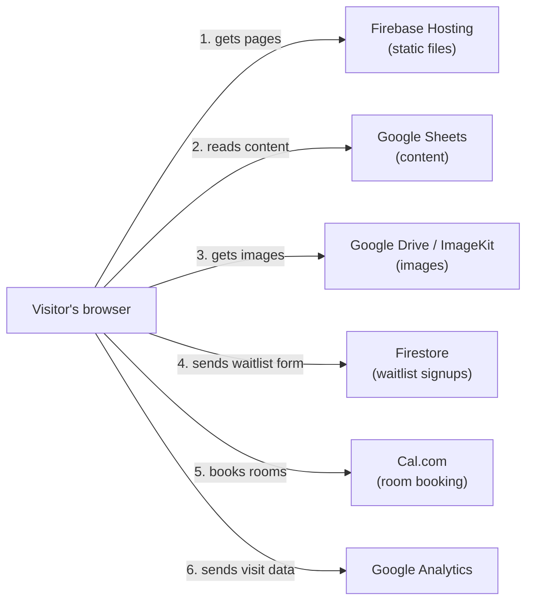
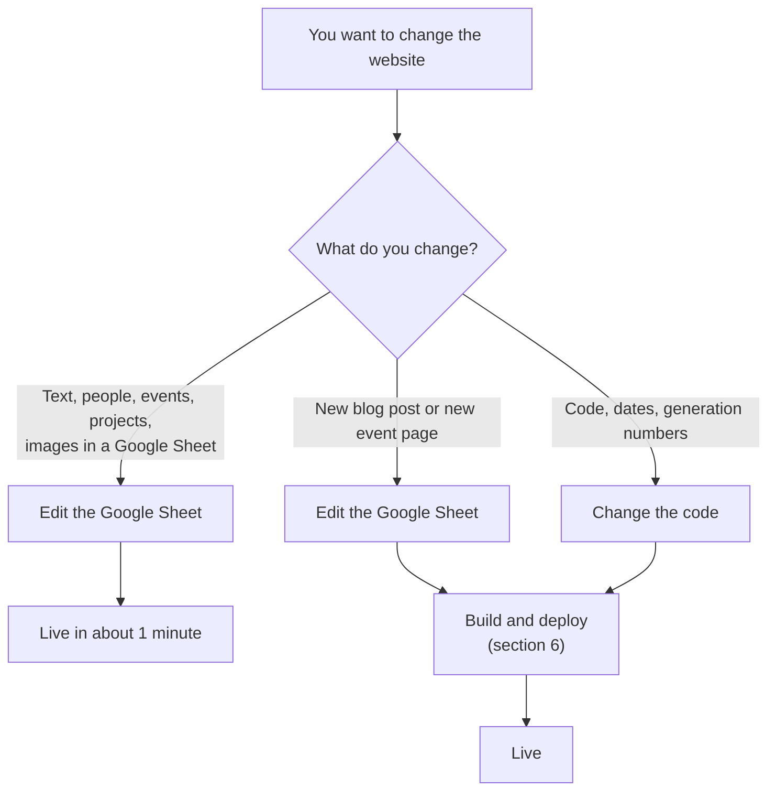
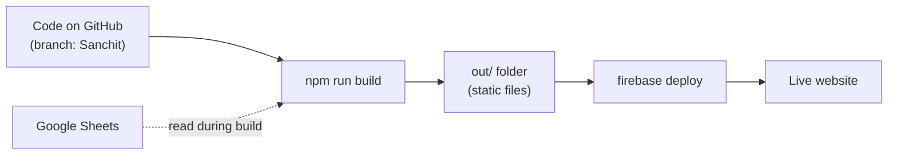

# YETI Website: Handover Guide

**For:** the YETI IT team
**Date:** 9 October 2026
**Language:** ASD-STE100 Simplified Technical English

---

## 1. Summary

- The website address is **yeti-dresden.org**. The address **yeti-leipzig.org** shows the same website and opens the Leipzig page.
- The website is a set of **static files** on **Firebase Hosting**. No server runs code.
- Most content comes from **5 Google Sheets**. The YETI team edits these sheets. A developer is not necessary for this.
- The waitlist form sends data to **Firestore** (a Google database).
- Code changes go live only when you **build** and **deploy** by hand. There is no automatic deploy.

| Item | Value |
|---|---|
| Code | GitHub: `Pushpit07/yeti-website` |
| Production branch | `Sanchit` (not `main`) |
| Hosting and database | Firebase project `yeti-dresden` |
| Framework | Next.js 15, React 19, TypeScript, Tailwind CSS |

---

## 2. How the website works

1. The browser gets the pages from Firebase Hosting.
2. The browser reads the content from the Google Sheets. It reads them each time a page opens.
3. The browser gets images from Google Drive, ImageKit, or the `public/` folder.
4. The waitlist form writes each signup to Firestore.
5. The Rooms page (`/rooms`) uses Cal.com for room bookings.
6. Google Analytics records visits. It works only on the live website.

---

## 3. The Google Sheets

| Google Sheet | Tabs | What the tabs control |
|---|---|---|
| [Contributors](https://docs.google.com/spreadsheets/d/1aIO1SYEXukAmM4sqwHKuArc2Y6JaGlIt-Ep-ldg43aI) | Ober Yetis, Yeti Board, Partners, Mentors, Fireside chat speakers | Contributors pages, partner logos |
| [Content](https://docs.google.com/spreadsheets/d/1eJjJxiXwQlawNCueugrR73QnaaRZiIEj-Vl_0xp2kZU) | Blogs, Yeti Media Content, Testimonials, FAQs | Blog, city page media, testimonials, FAQ |
| [Projects](https://docs.google.com/spreadsheets/d/1jTl9MdYqhrDMwBRqBA776LfFFMiGohP3u0utjpA7lu4) | All Projects, Made in Yeti | Projects page, makerspace activity |
| [Admin](https://docs.google.com/spreadsheets/d/1JN35Ql-K4WInjh11Of7Jtgp63MqE-hpZMzRbCSN29aM) | Events, Yeti Location Data, Application, Yeti Contacts | Events, city pages, application pages, footer |
| [Headquarters](https://docs.google.com/spreadsheets/d/1K2s1z3jRGoAS6Z2uU4wpRppwH5MOb6ckoqrvsFXYqdw) | Makerspace | Makerspace machines |

**Rules:**

- Do not change the tab names. The code uses the exact names.
- Do not change the column headers. The code uses the exact headers.
- Keep the sharing setting "Anyone with the link can view". If you change it, the website cannot read the content.
- For an image, put a Google Drive share link or an ImageKit link in the cell. The code changes Drive links into image links.

The file [lib/sheets/new.ts](../lib/sheets/new.ts) connects each tab to the code.

---

## 4. How a change goes live

### Changes that do not need a deploy

Edit the Google Sheet. New visitors see the change in about 1 minute.

The browser of a returning visitor keeps a copy (cache) for 10 to 60 minutes. To see the change immediately, add `?nocache=1` to the address.
Example: `https://yeti-dresden.org/events?nocache=1`

### Changes that need a build and deploy

- **A new blog post.** The blog list shows it immediately. Its own page shows "404" until the next deploy.
- **A new event page.** The events list shows it immediately. The page `/events/<name>` exists only after the next deploy.
- **The footer contact data** (Admin sheet, Yeti Contacts tab).
- **Application dates and generation numbers.** These are in [lib/constants.ts](../lib/constants.ts).
- **All code changes.**

---

## 5. Waitlist and admin panel

- The pages `/application/dresden` and `/application/leipzig` have a waitlist form.
- The form writes each signup to Firestore at `waitlist/{city}/generations/{generation}/signups`.
- The admin panel is at `/adminconsole/signuplist`. Use it to see, filter, and export signups to Excel.
- The admin login data is in [app/adminconsole/signuplist/page.tsx](../app/adminconsole/signuplist/page.tsx).
- The panel writes each login attempt to Firestore at `credentials/waitlist/logins`.

> **Warning:** The admin login is not secure. Read section 7.

---

## 6. How to change and deploy the code

**You need:**

- Node.js 20
- Firebase CLI: `npm install -g firebase-tools`
- Access to the Firebase project `yeti-dresden`

**Procedure:**

1. Get the code: `git clone https://github.com/Pushpit07/yeti-website.git`
2. Go to the production branch: `git checkout Sanchit`
3. Install the packages: `npm ci`
4. Start the local website: `npm run dev`
5. Open `http://localhost:3000`. Make and test your change.
6. Commit your change. Push it to the `Sanchit` branch.
7. Log in to Firebase (first time only): `firebase login`
8. Build the website: `npm run build`. The build takes a few minutes.
9. Deploy the website: `firebase deploy --only hosting`

> **Caution:** `firebase deploy` does not build the website. Always do step 8 before step 9. If you do not, Firebase deploys the old `out/` folder or stops with an error.

**To go back to an earlier version:** Open the Firebase Console. Go to **Hosting → Release history**. Select the earlier release. Click **Rollback**.

**To add a page:** Make a folder in `app/` with a `page.tsx` file. Example: `app/team/page.tsx` becomes `/team`.

---

## 7. Known problems

### Do now

1. **The admin login is not secure.** The username and password are in the website code. Any visitor can read them in the browser. Replace this login with Firebase Authentication.
2. **Check the Firestore rules.** The rules are not in this repository. Open **Firebase Console → Firestore → Rules**. Make sure that the public cannot read the signups.

### Do later

3. **The Docker files are out of date.** `Dockerfile` and `docker-compose.yml` expect a server build. The website now builds static files. Use Firebase Hosting only.
4. **The GitHub check runs on the wrong branch.** [.github/workflows/ci.yml](../.github/workflows/ci.yml) runs on `main`. Production uses `Sanchit`. This workflow does not deploy.

---

## 8. Accounts to hand over

Give the new IT team owner or admin access to each item:

- [ ] GitHub repository `Pushpit07/yeti-website`
- [ ] Firebase project `yeti-dresden` (Hosting and Firestore). Contact: **Sanchit**.
- [ ] The 5 Google Sheets and the Google Drive folders with images
- [ ] Domains `yeti-dresden.org` and `yeti-leipzig.org` (registrar and DNS). Contact: **Sanchit**.
- [ ] Google Analytics 4 (`G-7ZZ9BJPPXS`) and Google Ads (`AW-17100411946`)
- [ ] Cal.com account `yeti-fellowship` (room booking)
- [ ] ImageKit account

---

## 9. Important files

| File | What it does |
|---|---|
| [lib/sheets.ts](../lib/sheets.ts) | Reads data from the Google Sheets |
| [lib/sheets/new.ts](../lib/sheets/new.ts) | Connects each data type to a sheet and tab |
| [lib/constants.ts](../lib/constants.ts) | City data, generation numbers, application dates |
| [lib/firebase.ts](../lib/firebase.ts) | Firebase settings |
| [components/WaitlistModal.tsx](../components/WaitlistModal.tsx) | Waitlist form |
| [app/adminconsole/signuplist/page.tsx](../app/adminconsole/signuplist/page.tsx) | Admin panel |
| [firebase.json](../firebase.json) | Hosting settings and address redirects |
| [next.config.ts](../next.config.ts) | Build settings |

Each folder in `app/` is one page of the website.

---

## 10. Words in this guide

| Word | Meaning |
|---|---|
| Build | Make the static files from the code (`npm run build`). |
| Deploy | Send the static files to Firebase Hosting (`firebase deploy`). |
| Static files | HTML, CSS, JavaScript, and image files. No server code runs. |
| Cache | A copy of data that the browser keeps for a short time. |
| Firestore | The Google database that keeps the waitlist signups. |
| Tab | One sheet inside a Google Sheet file. |

For more details and the contacts of the original developers, read [README.md](../README.md).
